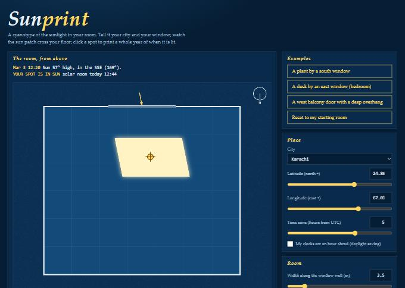
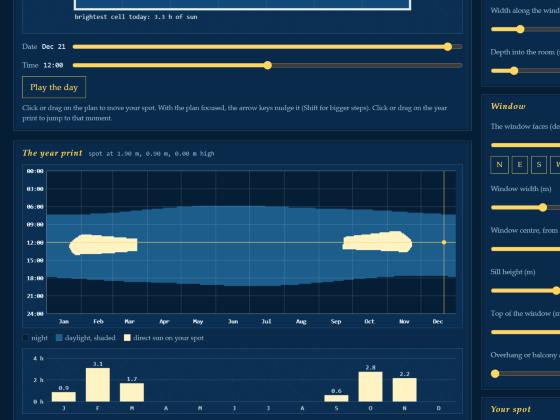

# Sunprint

> A cyanotype of the sunlight in your room: where the sun lands, and a one-image calendar of when it reaches your desk or plant, all year.

Tell Sunprint your city, your room and your window. It draws the room from above with the **patch of sunlight crawling across the floor** at the true angle for any day and hour. Then click a spot (your plant, your desk, your bed) and it prints a **year-long calendar of exactly when direct sun reaches it**: sunlight shown as "exposed" white on deep cyanotype blue, the way real sun prints are made.



---

## Contents

- [Highlights](#highlights)
- [Quick start](#quick-start)
- [How to use it](#how-to-use-it)
- [What the year print shows](#what-the-year-print-shows)
- [How it works](#how-it-works)
- [Project structure](#project-structure)
- [Testing](#testing)
- [Security & privacy](#security--privacy)
- [Accessibility](#accessibility)
- [Known limitations](#known-limitations)
- [Roadmap](#roadmap)
- [Skills & methodology](#skills--methodology)
- [Credits & license](#credits--license)

---

## Highlights

| Feature | What you get |
|---|---|
| **Live sun patch** | The lit area on your floor or desk, for any date and time, with the Sun's compass direction and height. Drag the sliders or press *Play the day*. |
| **The year print** | A 365-day by 24-hour picture of when your spot is in direct sun. Click or drag on it to jump the room to that moment. |
| **Whole-floor map** | Tick one box to colour every part of the floor by how many hours of sun it gets today: find the brightest place for a plant. |
| **Monthly bars** | Average hours of direct sun per day for each month, and a plain-English summary of the sunniest and dimmest months. |
| **Window design** | Window size, sill and top heights, and an overhang or balcony above it (watch it shade the high summer sun but welcome the low winter sun). |
| **Any place on Earth** | 33 built-in cities (including Karachi, Lahore, Islamabad, Delhi, Dubai, London, New York and Sydney) or type your own latitude and longitude. |
| **Share and save** | Copy a link to your exact room, or download the year print as a PNG. |
| **Private and offline** | Everything runs in your browser. No network requests, no accounts, nothing stored. |

## Quick start

There is nothing to install or build. **Double-click `index.html`**, or serve the folder with any static web server.

```bash
git clone https://github.com/sirajahmedshaikh454-dev/sunprint.git
cd sunprint
# open index.html in your browser
```

To run the tests (Node.js 18+):

```bash
npm install     # one dev-only dependency, used just to cross-check the maths
npm test
```

## How to use it

1. **Pick your city** (or type latitude, longitude and time zone). Tick *daylight saving* if your clocks are an hour ahead.
2. **Describe your room**: width and depth, which direction the window faces (`180` = south, with N/E/S/W buttons), and the window's width, position, sill height, top height, and overhang depth.
3. **Place your spot** by clicking or dragging on the plan (arrow keys nudge it; Shift for bigger steps). Set its surface height: `0` is the floor, `0.75` a desk.
4. **Read the room.** The plan shows the sun patch now; the HUD says whether your spot is in sun or shade; the year print below shows the whole year.
5. **Explore.** Drag the date and time sliders, press *Play the day*, click the year print to jump to a moment, or tick *Show hours of sun on the whole floor*.
6. **Start from an example** (a plant by a south window, a desk by an east window, a west balcony door with a deep overhang), then change anything.



## What the year print shows

Each column is a day of the year, each row a time of day. **Dark blue** is night, **mid blue** is daylight but your spot is shaded, and **white** is direct sun on your spot.

The picture above is a plant on the floor 0.9 m inside a south-facing window in Karachi. It gets sun only at midday in **spring and autumn**, and the reason is geometry you can read straight off the print:

- In **summer** the sun is nearly overhead. Its light comes almost straight down through the window and lands against the wall, so the plant is shaded.
- In **winter** the sun is low and its light stretches far across the room, landing *behind* the plant.
- Only when the Sun is between about 45 and 66 degrees high does the patch land right on that spot.

That is the kind of thing you cannot see by looking out of the window, and exactly why it is worth printing.

## How it works

### Where is the Sun?

`solar.js` uses NOAA's low-precision solar position algorithm (a series for the equation of time and the Sun's declination), checked against the full [astronomy-engine](https://github.com/cosinekitty/astronomy) library: the **worst error across 8 places and the whole year was 0.53 degrees**, far finer than a window needs. It also computes the **equation of time** (the Sun runs up to 16 minutes fast in November and 14 slow in February), so "solar noon" is real: Karachi's is near 12:18 in mid-November, not 12:00.

### Where does the light land?

`sunlight.js` works in room coordinates: `x` along the window wall, `y` into the room, `z` up. Only the Sun's azimuth *relative to the wall* matters (`delta = sunAzimuth - facing`). A ray through window point `(xw, zw)` reaches a surface at height `h` at:

```
x = xw - (zw - h) * sin(delta) / tan(elevation)
y = (zw - h) * cos(delta) / tan(elevation)
```

- **The light patch** is that mapping applied to the four corners of the window, then clipped to the room.
- **"Is this spot lit?"** is the inverse mapping: trace back toward the Sun and see whether the ray passes through the window. It is exact, needs no polygon maths, and is what makes the whole-year print cheap.
- **An overhang** of depth `D` hides every window point higher than `top - D * tan(elevation) / cos(delta)`, which is why a small overhang blocks the high summer sun but lets the low winter sun in.

### The year print

For every day and every 10-minute slot, the Sun's position is turned into a lit / shaded / night value for the spot: 52,560 samples. The sun table depends only on the place, so it is cached: a **cold computation takes about 22 ms, and dragging a window or spot slider afterwards about 1.5 ms**.

## Project structure

```
sunprint/
├── index.html       # the page
├── style.css        # the cyanotype look: Prussian blue, exposed white, gold
├── app.js           # drawing, controls, sharing, PNG export
├── solar.js         # sun position, equation of time, solar noon, calendar
├── sunlight.js      # window and room geometry, year print, floor map
├── state.js         # defaults, clamping of every setting, the share-link format
├── cities.js        # 33 places: latitude, longitude, standard UTC offset
├── *.test.js        # 22 tests
└── docs/            # screenshots
```

All scripts are plain classic scripts (no modules, no build step), which is why the page works when opened straight from disk.

## Testing

```bash
npm install && npm test
```

**22 tests** cover:

- **Sun position:** agrees with a full astronomy library to within 0.6 degrees in both hemispheres across the year; textbook facts (London's winter-solstice noon sun is about 15 degrees high, the Sun is overhead on the Tropic of Cancer at the June solstice, noon sun is due south in the northern hemisphere); sunrise in the east; the equation of time at its famous extremes.
- **Geometry:** the patch's depth and sideways shift against hand calculations; the overhang formula; no light at night or from behind the wall; clipping to the room.
- **An independent ray trace.** The inverse "is it lit?" test and the polygon patch share a formula, so a sign error could hide in both. A separate test traces rays using compass (east/north/up) vectors only, with none of the shortcut maths, for walls facing 8 different directions and 32,000 random suns and points, with and without overhangs. A wrong east-west sign cannot pass it.
- **Year print:** a south window with an overhang lights a desk in winter but not at the summer noon; a north window in the northern hemisphere gets none in December; the southern hemisphere mirrors the northern; the sun-table cache is reused and rebuilt correctly.
- **Settings and links:** every setting is clamped, the window and spot stay inside the room when the room shrinks, links round-trip, junk links (500 random garbage strings) never produce a non-number, an empty value is ignored rather than read as zero, and 29 February is not shown as 1 March.

**Also checked in a real browser:** typing numbers digit by digit, presets, click-to-jump on the year print, the whole-floor map, share-link restore (including junk links), PNG export, the easter egg, an extreme place whose time zone disagrees with its longitude, and the phone layout (no sideways scroll, no tap target under 28 px), all with zero console errors.

## Security & privacy

- **No network, no storage.** The page makes no requests (no fonts, no analytics, no CDN) and stores nothing. Closing the tab forgets everything.
- **No injection surface.** Every piece of text reaches the page through `textContent`; there is no `innerHTML`, `eval`, or third-party content. A shared link is parsed number by number: unknown keys, non-numbers and empty values are ignored, and every number is clamped.
- **The link holds your room, not your address.** Latitude and longitude are rounded to two decimals (about 1 km) in the link. Copying the link from a page opened as a file copies only the settings (the part after `#`), never your computer's file path.
- **No location prompts.** It never asks for your location; the default city is just a starting point.
- **No Content-Security-Policy tag, deliberately.** A policy that restricts scripts to the page's own origin is unreliable on `file://` pages, and this page has no inline scripts, no third-party content and no dynamic code to restrict. A security review confirmed that is acceptable here.
- **Dependencies:** none at runtime. One dev-only dependency ([astronomy-engine](https://www.npmjs.com/package/astronomy-engine)) is used by the tests; `npm audit` reports 0 vulnerabilities.

An independent security review found nothing exploitable; its privacy suggestions were all applied.

## Accessibility

- Every control is a labelled native input or button with a visible focus ring, and all of it works from the keyboard (the plan responds to the arrow keys).
- The plan and year print canvases carry text descriptions that are kept up to date, and the same facts are also written as plain text: the HUD, the summary list and the monthly figures.
- The Sun's moving state is not announced continuously: the live-region noise a screen reader would hear during *Play the day* was removed after review.
- Sunlight is white on blue, which has strong contrast, and nothing relies on colour alone: the legend and the text summary say the same thing.

## Known limitations

- **Direct sun only.** No clouds, haze, neighbouring buildings, trees, or sky light. A real room is dimmer than the print says on a cloudy day and when the neighbour's wall is in the way.
- **A simple room.** A rectangular room with one rectangular window in one wall, and one flat measuring surface at a height you choose. No wall thickness, window frame, sloped ceiling or skylight.
- **The overhang is assumed to run the whole wall**, so it can hide slightly more sun than a narrow awning would for a very oblique Sun (the plan draws it across the whole wall to match).
- **Time zones are standard time.** The built-in list stores each city's standard offset; tick *daylight saving* yourself if your clocks are an hour ahead. Leap days are ignored (a typical 365-day year).
- **Polar latitudes are clamped** to 85 degrees.
- **Playing the day** was verified by driving the same steps by script; the in-app browser used for testing could not run animation frames in the background, so I did not watch it play.
- **Opened as a file:** the page uses no modules, so it should work when double-clicked, but the test browser could only open it from a local web server, so that was not tested directly.
- Tested in a Chromium-based browser only.

## Roadmap

- [ ] Neighbouring buildings and trees as obstacles.
- [ ] Side fins and awnings of a finite width.
- [ ] More than one window, and skylights.
- [ ] Real time-zone and daylight-saving rules per city and date.
- [ ] Export the year print as an SVG, and a printable poster layout.
- [ ] A "best window direction" finder for a given city.

## Skills & methodology

**How it was built**

1. **Pitch three, build one.** Three concepts were weighed (a sunlight tool, an echo-measuring tool that needs a microphone, a birth-sky poster); the sunlight idea won because it is useful every day, needs no permission or network, and has a visual (a cyanotype) that fits the physics.
2. **Correctness first.** The sun-position maths was written and tested before any page existed, cross-checked against a full astronomy library. When the first test run showed a 0.53-degree worst error (against a 0.5 guess), the *claim* was corrected, not the test faked.
3. **A single geometric idea, tested twice.** The "is this spot lit?" test is an inverse mapping that is also fast enough to print a whole year. It is checked against a polygon patch *and* against an independent ray trace, so errors cannot cancel.
4. **Floor, then ceiling.** The maths and its tests first; then the plan view; then the year print; then the extras (whole-floor map, share links, PNG export, the easter egg).
5. **One commit per change**, pushed straight away: 8 commits. Commits are gated on the real test exit code. (An early commit slipped through with a failing test because a `grep` in the pipeline reported success; the next commit fixed it and the gate was added.)
6. **Three independent reviews in parallel, then fix everything:**
   - A **security review** (a read-only subagent) found nothing exploitable, and made four privacy and robustness suggestions, all applied.
   - A **code review** (a second subagent with solar-geometry knowledge) found a drag that could get stuck on a right-click, play speed that depended on the display's frame rate, a solar-noon line that left the chart in unusual time zones, and the weak spot in my tests: a sign error would have passed. That produced the independent ray-trace test.
   - A **senior-engineer audit** (the *ponytail-audit* plugin, run by a third subagent) found the most important bug: **you could not type a number like `10` into a box**, because the first digit was clamped and the box rewritten mid-keystroke. It also found the year image being rebuilt every frame and the sun positions being recomputed needlessly.
7. **Fixing the typing bug properly.** A first fix stopped the box being overwritten but exposed a second problem: typing `1` on the way to `10` squashed the room and permanently dragged the window into a corner. Out-of-range values are now ignored while typing and clamped only when you leave the box.
8. **Browser verification** with viewport emulation and script-driven checks, including actually typing digit by digit.

**Skills, plugins and tools used**

| Tool | Used for |
|---|---|
| **astronomy-engine** (dev dependency) | Cross-checking the sun-position maths |
| **ponytail-audit** plugin (via a subagent) | Whole-repo senior-engineer audit |
| Security and code-review subagents | Independent, read-only, parallel reviews |
| Built-in browser (viewport emulation, page scripting) | UI, layout, typing and link checks |
| Node `node:test` | The 22 tests |

The visual direction (cyanotype: Prussian blue, exposed white, a system serif, no web fonts) was designed directly. System fonts also keep the page free of any network request.

**Bugs found and fixed during the build:** an over-tight accuracy claim, a test comparing azimuth where it is mathematically undefined, several wrong assumptions in my own tests (about where a low sun lands and about which spots a narrow window can reach), a hash-only address change not reloading the page, the typing bug and its side effect, a stuck drag, frame-rate-dependent playback, an off-chart solar-noon line, a link that would have leaked a file path, and screen-reader spam.

## Credits & license

- Sun position: NOAA's low-precision solar calculator algorithm; cross-checked against [astronomy-engine](https://github.com/cosinekitty/astronomy) by Don Cross (MIT).
- Code: MIT.

---

<details>
<summary>Spoiler: the easter egg</summary>

Click on the page (not in a box) and type **analemma**. A gold line appears across the year print: **solar noon**. A clock says noon at the same minute all year, but the Sun does not: it arrives up to 16 minutes early in November and 14 late in February. Plot where the Sun stands at one clock time all year and you get a figure of eight, the *analemma*. The gold line is that figure, unfolded. Type it again to hide it.

</details>
